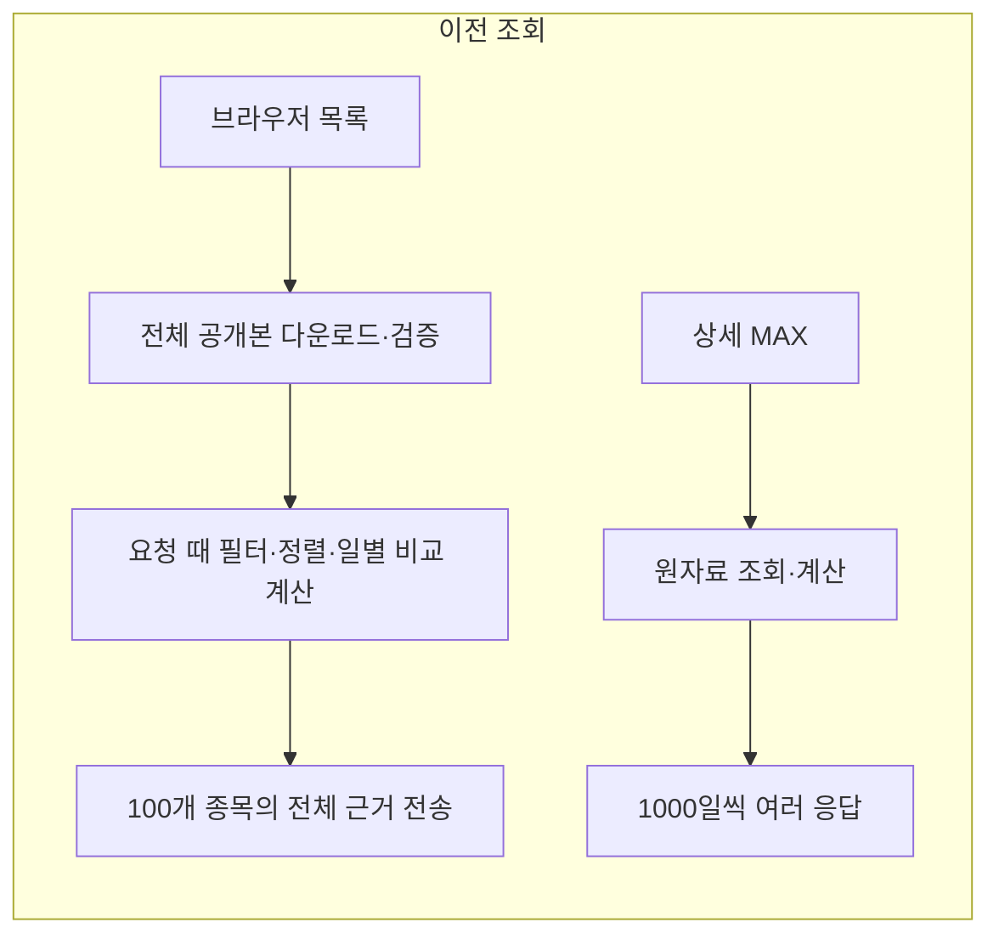
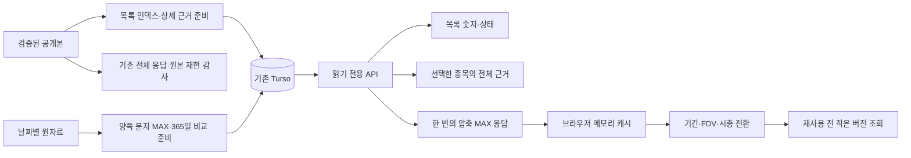

# 조회 성능 구조 · v0.6.0

목록과 차트의 계산 결과를 수집 뒤에 준비해 Turso에서 읽는다. 공급자 수집·원본 보관·검증된 공개본은 기존 절차를 따른다. 이 조회 구조는 아직 수집되지 않은 값을 채우거나 계산 기준을 바꾸지 않는다.

## 이전 구조와 변경점





## 저장과 공개 경계

- `daily_read_models`는 압축 JSON과 별도 메타데이터 해시를 보관한다. JSON은 32MiB, gzip은 4MiB로 제한한다.
- 목록 카탈로그는 정확한 공개본 ID·압축 원본 SHA·수집 시각을 고정한다. 전체 종목에서 기존 조건으로 필터·정렬한 뒤 페이지를 자른다. 100종목 단위의 상세 근거 묶음은 내용 해시로 연결한다. 모든 묶음이 저장된 뒤 카탈로그를 저장한다.
- 목록 정리는 준비한 대상 공개본과 다른 최신 한 세대를 보존한다. 연결된 상세 묶음은 삭제하지 않는다. 연결되지 않은 묶음에도 24시간 여유를 두며, 원본 공개본·원자료·감사 기록은 건드리지 않는다.
- `daily_raw_asset_revisions`는 실제 날짜별 셀이 바뀐 종목만 같은 쓰기 트랜잭션에서 증가한다. 기존 자산은 0부터 해석한다. 추가 쓰기량도 기존 무료 예산에 반영한다.
- 이력 생성은 쓰기 트랜잭션 밖에서 원자료를 읽고 계산한다. 저장 순간 해당 종목 revision이 그대로인지 확인한다. 자료가 바뀌면 그 결과를 공개하지 않는다.
- 일별 계산 결과는 공개본 ID와 독립적으로 보관한다. 조회 시 현재 검증된 공개본의 토큰·투자자산 적격성·완료일에 다시 연결한다. 다른 종목의 입력은 해당 종목의 결과를 무효화하지 않는다.
- 두 분자에 대해 `Capital(D) / (daily flow(D) × 365)`를 계산한다. 수익·시세가 없는 날짜, 0·음수·충돌·부분 수익, 정의 변경, 확인되지 않는 FDV의 보류 기준은 유지한다. 365일 비교는 최근 비교점을 제외한 이전 365일이 모두 유효해야 한다.

## 읽기 계약

| 경로 | 용도 | 준비한 결과가 없을 때 |
|---|---|---|
| `/api/screener?view=table` | 가벼운 목록과 메타데이터 일괄 비교 | 검증된 원본으로 같은 목록 응답 생성. 비교 요약은 `not_prepared` |
| `/api/coin?slug=…&publicationId=…&identity=…` | 선택한 종목의 원천 근거 | 같은 공개본의 원본을 확인해 읽음 |
| `/api/history?format=version&slug=…&expectedIdentity=…` | 완료일·토큰·revision 확인 | 원자료 기준 버전 또는 명시적 오류 |
| `/api/history?format=compact&slug=…&expectedIdentity=…&expectedRevision=…` | 양쪽 분자의 전체 MAX 압축 이력 | 현재 원자료로 같은 결과 생성 |
| 기존 기본 `/api/screener`, `/api/history` | 원본 감사·내보내기·기존 페이지/커서 호환 | 기존 계약 유지 |

새 이력 모드의 `from/to`는 MAX 응답을 자르지 않는다. 브라우저가 요청 당시의 기간 경계를 고정해 투영한다. 기존 schema 2 이력 모드의 날짜·커서·1000행 한도는 유지한다. 새 조회 경로는 `X-Tovenit-Read-Model` 응답 헤더로 준비된 결과 사용 여부를 구분한다.

브라우저는 gzip 크기·압축 해제 크기·SHA·날짜·원천 연결을 확인한 완전한 이력만 캐시한다. 최대 8종목·24MiB·64,000개 분자별 점·5분을 넘지 않는다. 다시 열거나 기간·분자를 바꾸면 버전을 먼저 확인한다. 확인 실패 시 캐시의 이전 숫자로 대신하지 않는다. 같은 MAX 요청은 함께 사용하고, 마지막 구독자가 닫으면 취소한다. 조회 제한 시간은 30초다.

## 생성과 무료 한도

```powershell
# 기본 실행은 검증·계획만 수행한다.
npx tsx scripts/prepare-table-read-model.ts
npx tsx scripts/prepare-daily-history.ts --cache C:/outside-git/history-model

# 기존 쓰기 전용 환경을 불러온 뒤 명시적으로 적용한다.
npx tsx scripts/prepare-table-read-model.ts --apply --max-estimated-writes 50000 --minimum-reserve 500000
npx tsx scripts/prepare-daily-history.ts --cache C:/outside-git/history-model --run-id history-model-YYYY-MM-DD --max-estimated-writes 50000 --time-budget-seconds 2400 --workers 4 --apply
```

Turso의 기존 읽기/쓰기 권한을 사용한다. API와 브라우저는 생성·정리 작업을 실행하지 않는다. 원격 쓰기는 월별 800만 크레딧·4GB 내부 보호선, 실행별 불변 한도, 50만 크레딧 유지보수 여유를 함께 지킨다. 변경 없는 결과는 쓰지 않는다. 결과를 확인할 수 없는 쓰기는 자동 재시도하지 않으며, 읽기로 현재 revision·해시·실행 예산을 확인한 뒤 재개한다.

스크리너 공개 작업 뒤에 목록과 이력을 준비하고, 일별 원자료 입력 뒤에도 이력을 갱신한다. 이력 준비는 수집 작업과 별도로 최대 20분인 job에서 실행하며 CLI 계산 시간은 900초, 쓰기 한도는 5만이다. 두 워크플로의 이력 준비는 같은 동시 실행 잠금을 사용한다. 수집이 자체 제한 시간을 모두 써도 준비 작업의 시간은 남는다. 원자료 revision이 같아도 완료일이 바뀌면 다시 계산하며, 같은 완료일의 새 공개본은 기존 결과를 재사용한다.

예산·시간이 부족하면 원본 공개와 저장된 원자료를 보존한 채 재개한다. 공급자 API를 추가 호출하거나 유료 요금제로 전환하지 않는다. DB 전체 이력의 확보율은 조회 결과 준비율과 별도로 본다.

## 검증 근거

2026-10-20 공개본 `data-39370959654-1-complete`의 7,324개 종목을 대상으로 기존 조회와 332개 필터·정렬·분자 조합을 대조했다. 목록 순서·페이지·전체 수·커버리지와 열별 값·근거를 보존했다. 100행과 계산 가능한 비교 요약 100행을 포함한 응답은 630,658바이트였다. 이 수치는 압축 전 JSON 크기이며 실제 전송 지연을 뜻하지 않는다.

Aave의 2,209일 MAX는 압축 이력 응답 하나에 들어간다. 2024-03-05 FDV `1,687,920,736.48512`와 같은 날짜 Revenue `184,635`에서 P/R `25.046390846436676`을 확인했다. 해당 날짜 Holders Revenue 0은 배수 미산출로 유지한다. 실제 배포 응답 지연과 브라우저 결과는 출시 시 별도로 측정한다.

첫 원격 입력은 위 공개본의 검증된 토큰과 원자료가 연결된 2,837종목에 대해 완료했다. 압축 이력 93,027,200바이트와 목록·상세 묶음 6,876,570바이트를 저장했으며, 총 14,570크레딧을 반영했다. 2026-10-20 07:25 UTC 읽기 검증에서 DB 크기는 1,409,695,744바이트, 10월 내부 예약량은 7,294,271크레딧이었다. 이는 조회 결과 준비의 완료 기록이며, 모든 종목의 모든 과거 수익·FDV가 확보됐다는 뜻은 아니다.
